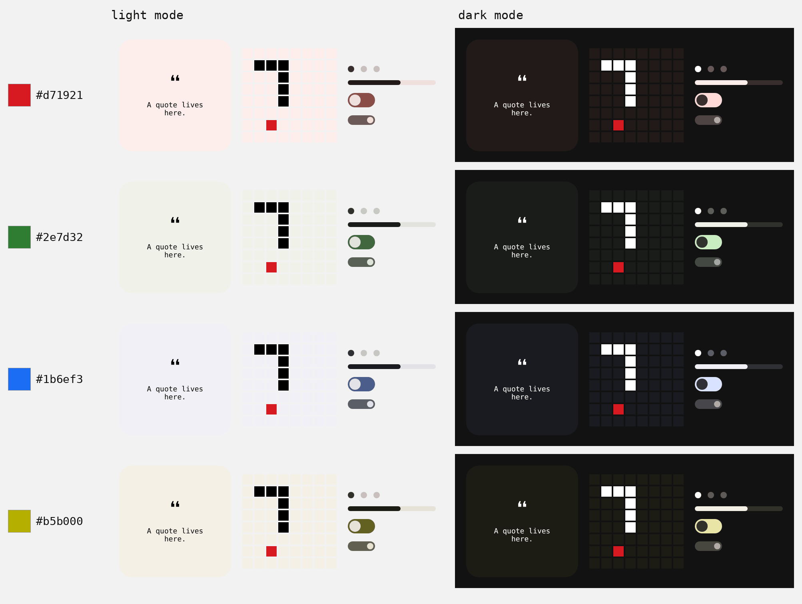
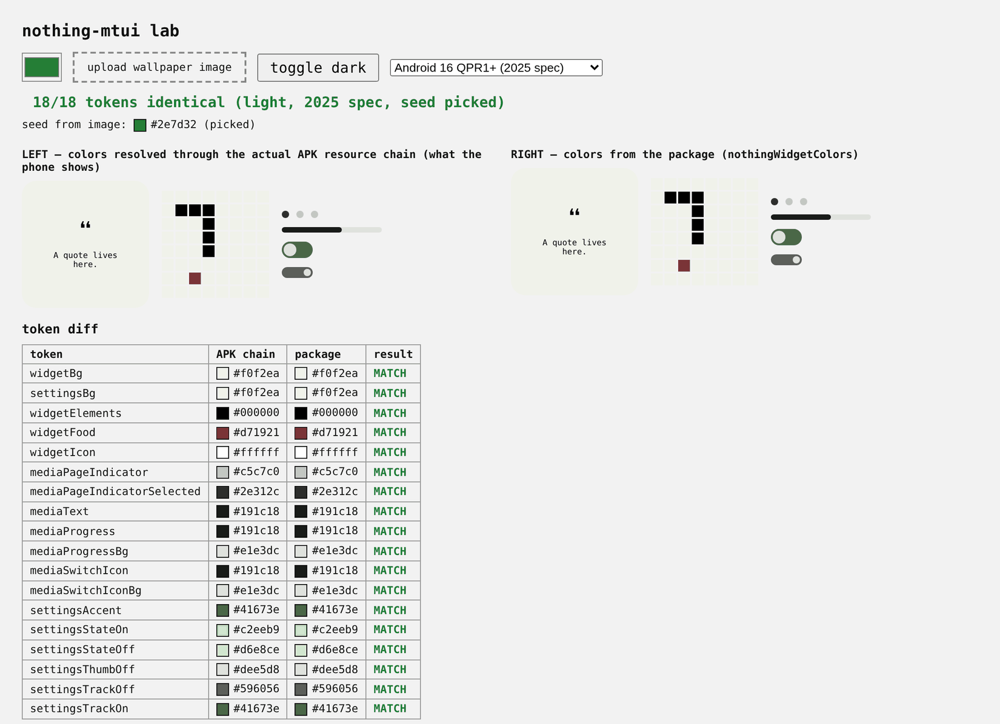

# nothing-mtui

Nothing widget color tokens, taken from the `com.nothing.communitywidgets` app
(version 52): `res/values/colors.xml` for light mode and
`res/values-night/colors.xml` for dark.

Unofficial and not affiliated with, endorsed by, or supported by Nothing Technology Limited.
The token values are factual color data; the package is a mapping convenience.

What the app does: widget backgrounds use Android's Material You neutrals
(`system_neutral1_50` in light mode, `system_neutral1_900` in dark), foreground
elements stay black or white, and accents use `system_accent1` and
`system_accent2`. A token the night resources don't override points at the same
shade in dark mode. One nuance: dark `widget_settings_bg` adds
`android:lStar="12"`, which this package applies on top of `system_neutral1_900`.

## What it looks like

The same widgets, colored by the package for four wallpaper colors:



## Usage

Works in browsers, React Native and Node 18+. It's an ES module, so use
`import` (a CommonJS `require` only works on Node versions that can require ESM). A native Kotlin/Java app does not need this package: Android 12+
exposes the same colors directly as `android.R.color.system_neutral1_50` etc.,
so there you only need the token mapping under [Tokens](#tokens).

```js
import { themeFromSourceColor, argbFromHex } from '@material/material-color-utilities';
import { nothingWidgetColors } from 'nothing-mtui';

// Material You gives you a Theme; pass it straight in.
const theme = themeFromSourceColor(argbFromHex('#d71921'));
const colors = nothingWidgetColors(theme, 'dark');
colors.widgetBg; // '#221a19' — background for the Nothing widget

// Or skip Material You and pass the wallpaper seed directly.
nothingWidgetColors('#d71921', 'dark');

// No palette: colors for FALLBACK_SEED.
nothingWidgetColors(null, 'light');

// Match a phone on Android 14 to 16 QPR0 instead of the newer default.
nothingWidgetColors('#d71921', 'dark', { spec: '2021' });
```

A runnable version of this is in `sample/material-you-to-nothing.mjs` in the
GitHub repo (the `sample/` and `scripts/` folders aren't in the npm package):

```
node sample/material-you-to-nothing.mjs '#2e7d32'
```

`palette` can be:

- a seed color: `'#rrggbb'` or `'#rgb'` (the `#` is optional), or an opaque
  ARGB int, signed (Android's `Color` ints) or unsigned;
- a material-color-utilities `Theme` or `DynamicScheme`, which gets rebuilt from
  the seed it carries (this package models Android's default wallpaper style);
- a palette you read off a device in the mode you're using it for, shaped
  `{ neutral1: { 0: '#…', 10: '#…', 50: '#…', …, 1000: '#…' }, neutral2, accent1, accent2 }`.
  The keys are Android shades (`system_neutral1_50` → `neutral1[50]`), not
  tones, and every shade the tokens use must be there. Colors can be anything a
  seed can be, and come back as lowercase `'#rrggbb'`. 8-digit strings are
  refused, because Android writes them `#AARRGGBB` and CSS writes `#RRGGBBAA`.
  A palette from `paletteFromSeed` works too, but only in the mode it was built
  for, because the 2025 spec's accent1 differs between light and dark;
- `null` or `undefined`, for `FALLBACK_SEED`.

Anything else throws instead of quietly returning grey fallback colors.

## Exports

- `nothingWidgetColors(palette, mode, { spec })` — resolved tokens for `'light'`
  or `'dark'`. `spec` is described below and only affects seeds.
- `paletteFromSeed(seed, { spec, mode })` — the wallpaper palette Android builds
  from a seed, using its default "tonal spot" style. The result includes the
  `spec` and `mode` it was built for. Android changed the math in
  Android 16 QPR1, so there are two specs:

  | `spec` | Android | accent1 | accent2 | neutral1 | neutral2 |
  |---|---|---|---|---|---|
  | `'2025'` (default) | 16 QPR1 and later | 32, or 26 in dark mode | 16 | 5 | 8.5 |
  | `'2021'` | 14 to 16 QPR0 | 36 | 16 | 6 | 8 |

  The numbers are chromas. Android 12 and 13 used other values and aren't
  covered. A seed with chroma under 5 has no usable hue, so Android swaps in a
  fixed blue (`#1b6ef3`), and this does the same.
- `withLstar(color, lstar)` — sets CIE L\* and keeps hue/chroma, the way Android
  applies an `android:lStar` attribute. Takes any color a seed can be and
  returns lowercase `'#rrggbb'`; an lStar outside 0–100 leaves the color as is.
- `TOKENS` — the raw token-to-shade mapping (frozen).
- `FALLBACK_SEED` — `'#8a8f99'`, the blue-grey seed used for `null`. It is not
  Android's own static fallback colors.

## Tokens

Each token and the Android color it comes from. On native Android you can use
these resources directly (`android.R.color.system_neutral1_50` and so on, API 31+).

| Token | Light | Dark |
|---|---|---|
| `widgetBg` | `system_neutral1_50` | `system_neutral1_900` |
| `settingsBg` | `system_neutral1_50` | `system_neutral1_900` at lStar 12 |
| `widgetElements` | `#000000` | `#ffffff` |
| `widgetFood` | `#d71921` | `#d71921` |
| `widgetIcon` | `#ffffff` | `#ffffff` |
| `mediaPageIndicator` | `system_neutral1_200` | `system_neutral1_600` |
| `mediaPageIndicatorSelected` | `system_neutral1_800` | `system_neutral1_10` |
| `mediaText` | `system_neutral1_900` | `system_neutral1_50` |
| `mediaProgress` | `system_neutral1_900` | `system_neutral1_50` |
| `mediaProgressBg` | `system_neutral1_100` | `system_neutral1_800` |
| `mediaSwitchIcon` | `system_neutral1_900` | `system_neutral1_50` |
| `mediaSwitchIconBg` | `system_neutral1_100` | `system_neutral1_800` |
| `settingsAccent` | `system_accent1_600` | `system_accent1_100` |
| `settingsStateOn` | `system_accent1_100` | `system_accent1_100` |
| `settingsStateOff` | `system_accent2_100` | `system_accent2_100` |
| `settingsThumbOff` | `system_neutral2_100` | `system_neutral2_300` |
| `settingsTrackOff` | `system_neutral2_600` | `system_neutral1_700` |
| `settingsTrackOn` | `system_accent1_600` | `system_accent2_700` |

`lStar 12` means the color is `system_neutral1_900` with `android:lStar="12"`
applied (see `withLstar`).

`widgetIcon` and `settingsStateOff` are defined in the app's `colors.xml` but
nothing in the decompiled app references them, so the app may never draw them.

## APK fixtures

The mapping was checked against the app's own decoded resource files. Those
files belong to Nothing, so they are not in this repo. You only need them to
re-run that check (`npm run verify:apk`) or the page in `sample/lab`; the
package itself doesn't use them.

To get them, decode `com.nothing.communitywidgets` with apktool or jadx and copy
these files into `sample/apk-fixtures/`, keeping the folder structure:

```
values/colors.xml
values-night/colors.xml
color/default_color_background_dark.xml
drawable/widget_2x2_bg.xml
layout/widget_quotes_card_2x2.xml
layout/widget_snake_card_2x2.xml
layout/mediaplayer_widget_container.xml
```

`sample/apk-fixtures/` is gitignored, so they won't get committed by accident.

With the fixtures in place, the lab page resolves each token through the app's
own resource files on the left and calls the package on the right:



`sample/lab` has to be served over HTTP from the repo root, because it loads
`/node_modules/...` and `scripts/token-map.json`:

```
npm install
python3 -m http.server 8000   # then open http://localhost:8000/sample/lab/
```

## Licence

The code in this repository is released under the [MIT License](LICENSE).

"Nothing" is a trademark of Nothing Technology Limited, used here only to
describe what this package is compatible with.
